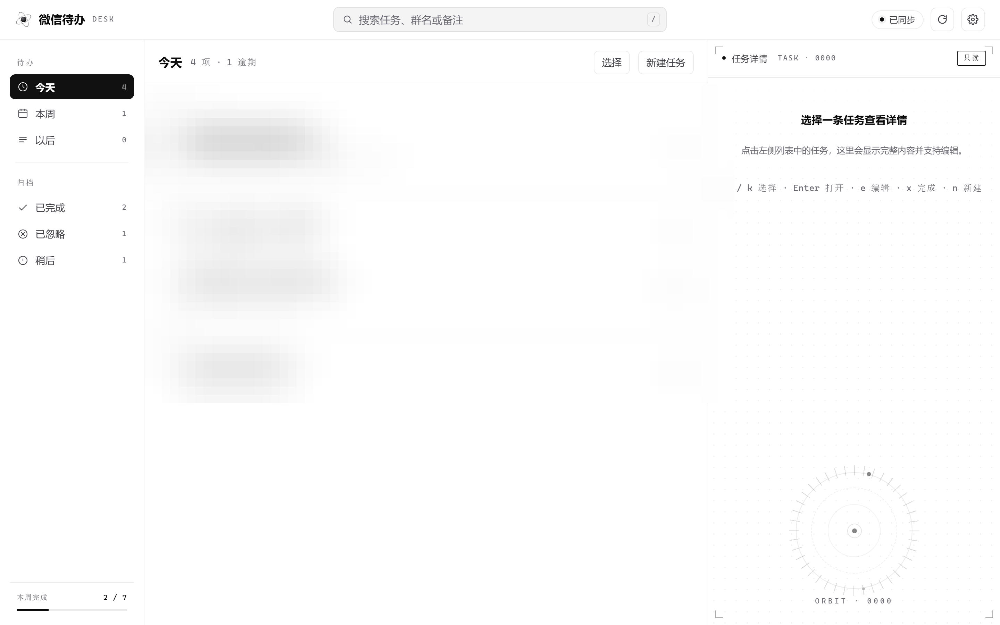
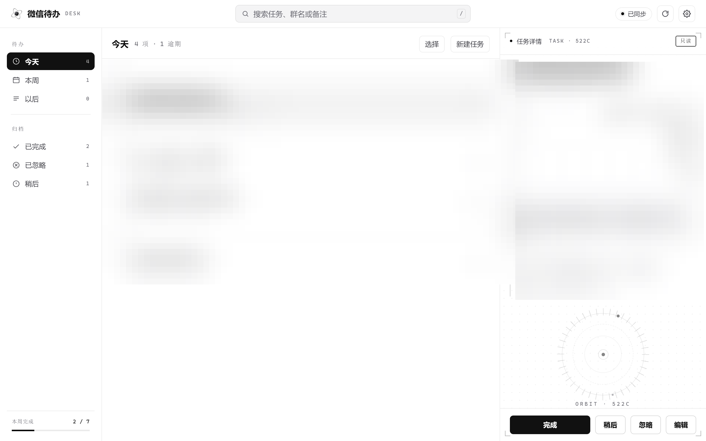
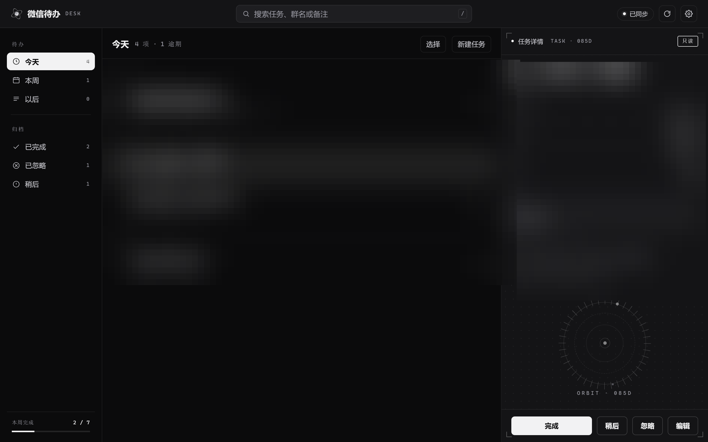
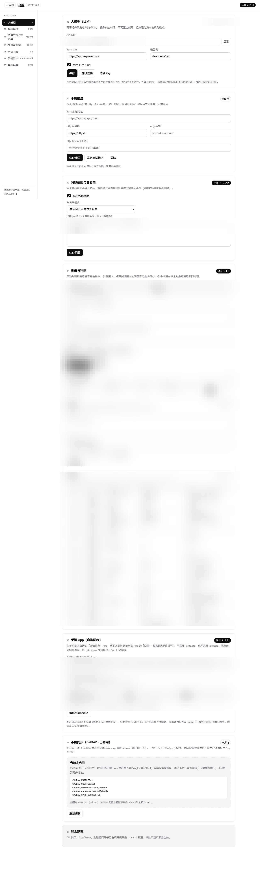
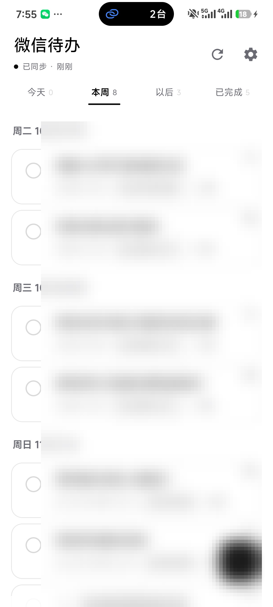
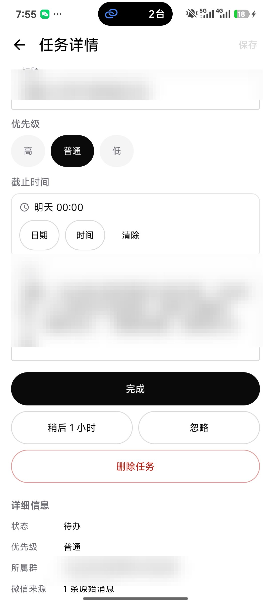
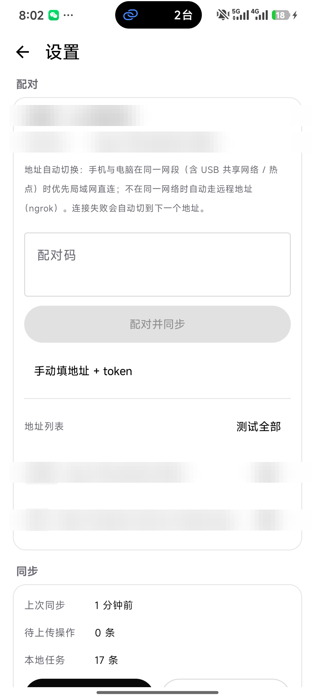
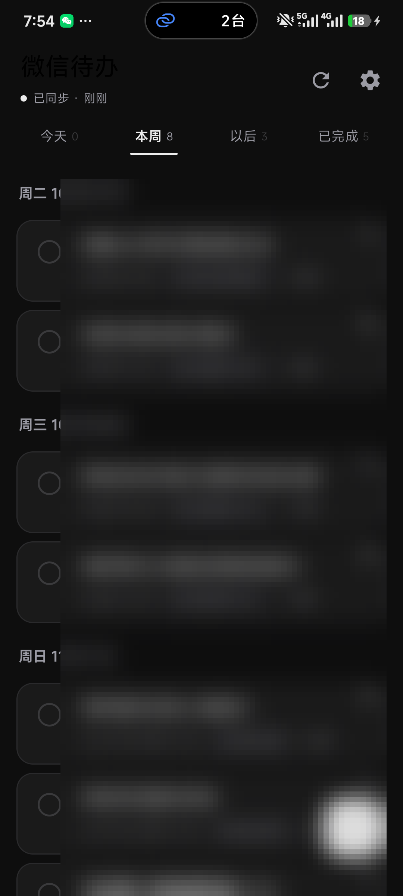

# 微信待办 · WeChat Task Hub

把电脑版微信的重要消息**自动归纳成待办任务**，推送到手机，并提供一个手机上可用的**任务表 PWA**。

```
微信 PC ──► WeChatDataAnalysis（本地只读 API）
                │
                ▼
      采集：每 120s 一轮，启动 8s 先采一次
      每会话 localId 游标续采 + 晚到消息深扫
                │
                ▼
      事项账本：LLM 归并 / 拆分 / 更新
        （多消息→一事项，一条消息→多任务）
                │
                ▼
          SQLite：events + tasks
                │
        ┌───────┴────────┐
        ▼                ▼
  Bark / ntfy 推送   手机任务表 PWA
```

## 功能

- **采集（唯一采集方法）**：wcda 数据源为全自动「采集」——服务启动 8 秒后先按每会话 **localId 游标**采集一次，之后每 120 秒一轮；游标是微信 WCDB 行序（与 createTime 解耦），每轮只取 localId 大于游标的消息，首次建立游标或 localId 重装 / 换库时回退时间窗重采并重设游标。WCDA 分页按 createTime 排序、且没有 localId 过滤参数，所以另有**晚到消息深扫**：每 60 分钟按 24 小时时间窗重扫一次，不推进游标、按 `rawid` 去重，专门兜住「写入晚、业务时间旧」的消息；无游标且启动前无历史时回看最近 1 天，单轮最多处理 2000 条，未处理完的保留为「已入库未处理」留到下一轮。用户可见延迟为分钟级；设置页「运行状态」可查看连接三态 / 上次采集 / localId 游标数 / 待处理消息与会话 / 失败队列 / 上次结果。
- **增量采集**：按会话 localId 游标补齐未处理过的消息（含停机 / 断网期间漏掉的），已处理过的不会重复归纳；无游标时按时间窗回退，超出单轮预算的余量保留为「已入库未处理」在下一轮继续。
- **@/点名身份判定**：自动识别我的 wxid、各群群昵称与群成员；被 @ 到别人、被点名指派给别人的消息**不再生成待办**；@ 我、直呼我（含外号 / 同音字 / 错别字）的照常生成；没有指定对象的群公告保持原有逻辑。设置页可手动补充别名、随时测试一句话的判定结果，并查看最近过滤记录
- **采集 / 置顶跟随**：采集全自动，无手动触发入口；后台默认每 2 分钟按会话 localId 游标续采，单轮最多处理 2000 条、未处理完的消息保留为「已入库未处理」自动留到下一轮，支持分页回溯长时间离线；无游标时按时间窗兜底；置顶变化默认 60 秒内同步到监控范围，新置顶聊天自动回补最近 2 小时；设置页「运行状态」可查看上次采集 / 置顶结果，并「同步置顶」
- **失败重试与失败队列**：单条消息处理失败不拖垮整轮——小批次（≤30 条）整批失败后逐条隔离重试，能处理的立即处理；大积压（>30 条）先隔离探测前 30 条，若探测样本**全部**失败（LLM/网络等整体性故障）本轮只写 `last_error`、**不计 attempts**，下一轮自动重试（避免一次短时故障把积压灌进失败队列）；只要样本里有成功，就按毒消息累计 attempts、多轮逐批排空。连续 3 轮仍整体性失败会推送「采集持续失败」high 告警（`source.last_error` 同步记录），避免静默卡住。同一条消息累计失败 `MESSAGE_MAX_ATTEMPTS`（默认 3）次后置为 `processed=2` 进「失败队列」（`processed`：0=待处理、1=已处理、2=失败队列）并推送 high 优先级告警（不受免打扰限制），不再阻塞同一会话的后续消息；设置页「运行状态 → 采集」可查看并一键「重试失败队列」
- **置顶白名单**：可只处理微信里置顶的聊天（自动同步，支持群聊+私聊），也可叠加自定义名单
- **事项账本（M:N）**：多条消息可归并成一个事项/待办，一条消息可拆成多个待办；后续消息会更新原任务的截止时间与来源，而不是重复新建
- **电脑端三栏**：≥1024px 为「分组导航 + 任务列表 + 详情面板」，白底黑白极简；时间分组（逾期 / 今天、本周按天、已完成按天；无截止时间的任务归「以后」）、搜索、快捷截止；任务详情显示**所属事项**（事项账本标题/摘要/状态）与**来源条数**，可改标题 / 优先级 / 截止 / 备注，已忽略 / 稍后可在导航找回，完成 / 忽略 / 稍后 5 秒内可撤销；支持批量选择（Shift 连选）批量完成 / 忽略 / 恢复 / **删除**，支持 `j/k`、`Enter`、`e`、`x`、`n`、`Esc` 快捷键；数据源断开时顶部给出可重试的提示横幅
- **手机任务表**：今天 / 本周 / 以后 / 已完成；归档区可切换 已完成 / 已忽略 / 稍后，支持完成、稍后 1 小时、忽略、恢复、删除、查看原文来源（手机端保持原布局，仅同步黑白配色）
- **自研安卓 App 同步**：手机装项目自带的「微信待办」安卓 App，**同一 Wi-Fi 时局域网直连**（`http://192.168.x.x:8765`），**在外网时走 ngrok 固定免费域名**（`https://xxx.ngrok-free.dev`，新版账号；旧版为 `.ngrok-free.app`；HTTPS）；靠「配对码」一次带上地址 + token，App 自动在局域网/远程地址间切换，离线可操作、联网自动补同步，支持到点提醒。教程见 [docs/手机同步.md](docs/手机同步.md)
- **网页内配置**：⚙ 设置页可直接填 LLM Key、Bark/ntfy 推送、私聊开关、白名单模式、身份判定（手动别名 / 过滤开关 / 判定测试 / 最近过滤），保存即生效；「运行状态」卡片可看数据源连接 / 上次采集 / localId 游标与采集参数 / 待处理与失败队列 / 上次结果 / 置顶 / 事项账本待处理数，并可同步置顶、重试失败队列；也能查看「手机 App」配对码与可用的局域网 / ngrok 地址并一键复制
- **推送**：Bark（iPhone）或 ntfy（Android）；一次采集轮内新建的待办在轮末**合并成一条推送**（标题「微信待办 +N」，最多 6 条明细），同轮没有新待办则不推；采集轮之外的即时推送行为不变。免打扰时段自动静默，每天可选定时摘要
- **本地优先**：数据只存本机 SQLite；服务默认只监听本机/局域网，远程访问通过 ngrok 隧道（免费固定 dev domain）按需开启

## 界面预览

| 电脑端三栏（1440×900） | 任务详情（含微信原文来源） |
|---|---|
|  |  |

| 深色模式（中性灰） | 手机任务表（浅色） |
|---|---|
|  |  |

> 截图中的群名、人名、账号、密钥、IP 与域名等敏感信息均已打码/模糊处理。

设置页（直接填 API Key，保存即生效）：



### 安卓 App（自研，替代第三方待办 App / 代理服务）

| 任务列表（浅色，按日期分组） | 任务详情（微信原文来源 / 所属事项） |
|---|---|
|  |  |

| 设置与双地址（局域网 + ngrok） | 深色模式 |
|---|---|
|  |  |

> App 源码在 [`android/`](android/)，安装包 `android/dist/app-release.apk`；装好后把电脑设置页「手机 App」卡片里的配对码粘贴进 App 即完成配对。
> 支持：离线操作 + 联网自动补推、到点提醒、新待办通知、局域网/远程地址自动切换、小米 HyperOS 自启动/省电引导。
> 构建方法见 [android/README.md](android/README.md)。

## 快速开始

> 从零配置（WeChatDataAnalysis / DeepSeek / Bark / ntfy / 手机访问）的完整图文步骤见 **[docs/配置教程.md](docs/配置教程.md)**。
> 手机同步用**自研安卓 App**（局域网直连 + ngrok 固定域名远程）：见 **[docs/手机同步.md](docs/手机同步.md)**。

### 1. 环境

- Windows 10/11，Python 3.10+（已在 3.13 验证）
- [WeChatDataAnalysis](https://github.com/LifeArchiveProject/WeChatDataAnalysis)（解密 + 读取微信 4.x 本地库，提供本地只读 API）
- 可选：DeepSeek / OpenAI 兼容大模型 Key；Bark 或 ntfy

### 2. 配置 WeChatDataAnalysis

1. 安装并启动 WeChatDataAnalysis 桌面端，登录微信 4.x；
2. 在应用里完成账号选择/数据库解密（首次使用按它的引导走）；
3. 默认本地 API 为 `http://127.0.0.1:10392`，浏览器打开 `http://127.0.0.1:10392/docs` 能看到接口文档即正常；
4. 无需额外 Token（它只监听本机）。

### 3. 配置本项目

```powershell
cd D:\微信通知总结\wechat-task-hub
Copy-Item .env.example .env   # 如果还没有 .env
notepad .env
```

至少要改：

| 变量 | 说明 |
|---|---|
| `APP_TOKEN` | 手机访问用的令牌，改成随机串 |
| `DATA_SOURCE` | `wcda`（WeChatDataAnalysis，默认）或 `demo`（演示模式，不连数据源）；旧配置里已删除的数据源会自动按 `wcda` 处理 |
| `WCDA_BASE` | WeChatDataAnalysis API 地址，默认 `http://127.0.0.1:10392` |
| `GROUP_WHITELIST` | 只监控的群（群名或 `xxx@chatroom`，逗号分隔）；留空 = 所有群 |
| `ME_NAMES` | 你的昵称/外号清单（识别 @我 / 直呼我；群昵称会自动从微信同步，通常不用手填） |
| `IDENTITY_FILTER` | `1`=丢弃「明确 @ 别人 / 点名别人」的消息；`0`=完全恢复旧逻辑 |
| `IDENTITY_FUZZY` | `1`=开启错别字/同音模糊匹配（只在 @/直呼/指派语境生效） |
| `LLM_API_KEY` | DeepSeek 等 OpenAI 兼容 Key；不填则用本地规则（也可以到网页右上角 ⚙ 设置里填） |
| `PUSH_BARK_URL` | iOS：Bark App 里的 `https://api.day.app/xxxxx` |
| `NTFY_TOPIC` | Android：ntfy 主题名（默认服务器 ntfy.sh） |

### 4. 启动（桌面快捷方式，推荐）

开发态用 **Python 脚本 + 桌面快捷方式**：

- 桌面 **「微信待办」**：双击即可
  - 如果 WeChatDataAnalysis 没运行 → 自动启动它；
  - 后台启动本项目服务（无控制台窗口）；
  - 等健康检查通过后自动打开任务表网页；
  - 如果服务已经在运行 → 只打开网页，不会重复启动。
- 桌面 **「停止微信待办」**：停止后台服务（同时停掉 ngrok 隧道子进程）。
- 开始菜单里也有同名快捷方式。

快捷方式丢了/换电脑：在项目目录运行一次：

```powershell
powershell -ExecutionPolicy Bypass -File .\scripts\install_shortcuts.ps1
```

> 仍然需要本机已安装 Python 和项目依赖（当前电脑已配置好）。
> 开发调试也可以直接 `.\scripts\start.bat`，日志在 `data\launcher.log`、`data\service.err.log`。

需要**免装 Python** 分发时，用打包层构建 Windows 绿色版 exe（PyInstaller onedir），详见 [packaging/README.md](packaging/README.md)：

```powershell
# 构建 → dist\WeChatTaskHub\WeChatTaskHub.exe（+ releases\*.zip）
powershell -ExecutionPolicy Bypass -File .\packaging\build.ps1
```

启动后访问地址：

```
本机访问  : http://127.0.0.1:8765/?token=xxxx
手机访问  : http://192.168.x.x:8765/?token=xxxx          （同一 Wi-Fi 直连）
远程访问  : https://xxx.ngrok-free.dev/?token=xxxx        （ngrok 固定域名，配好后自动生成；旧版账号为 .ngrok-free.app）
```

- **同一 Wi-Fi**：手机浏览器直接打开「手机访问」地址；Safari/Chrome 菜单里「添加到主屏幕」即可像 App 一样使用；
- **外网 / 校园网隔离**：用 ngrok 免费固定域名。在项目目录运行一次
  `powershell -ExecutionPolicy Bypass -File .\tools\ngrok_setup.ps1`（引导填 authtoken，免费注册），
  之后双击桌面「微信待办」会自动把隧道一起拉起来；`python tools\tunnel.py --check` 查看公网地址与链路状态；
- **手机 App（推荐）**：装自研安卓 App，用设置页「手机 App」卡片里的**配对码**一次配对；
  在家自动走局域网、出门自动走 ngrok，离线可勾选、联网自动补同步。
  完整步骤（ngrok 注册、免费额度、配对、排查）见 **[docs/手机同步.md](docs/手机同步.md)**。
- `.env` 的 `APP_BASE_URL` 一般**留空**：远程地址由隧道写入 `data/tunnel.json`，配对接口自动读取，不需要手填。

### 5. 没有数据源？先体验

```powershell
python run.py --demo
# 另开一个 PowerShell：
.\scripts\demo_seed.ps1
```

会写入 6 条虚构群消息并生成 3–4 条待办，手机任务表立即可见（不推送、不联网）。

### 6. 推送自检

启动后执行（把 token 换成你的 `APP_TOKEN`）：

```powershell
Invoke-RestMethod -Method Post -Uri "http://127.0.0.1:8765/api/push/test" `
  -Headers @{"X-Auth-Token"="<APP_TOKEN>"}
```

手机上收到「微信待办 · 测试」即说明 Bark / ntfy 配置正确。

## 在网页里配置 LLM（推荐）

1. 打开任务表，点右上角 **⚙**；
2. 填 **API Key**（DeepSeek / OpenAI / 硅基流动 / Ollama 等）、**Base URL**、**模型名**；
3. 点「保存」→ **立即生效，无需重启**；点「测试连接」可当场验证 Key 是否可用；
4. Key 会写回项目根目录 `.env`，下次启动继续生效；点「清除 Key」退回规则模式。

> 页面只显示 Key 的掩码（如 `sk-…abcd`），不会回显完整 Key。
> 常用 Base URL：DeepSeek `https://api.deepseek.com/v1`、OpenAI `https://api.openai.com/v1`、Ollama `http://127.0.0.1:11434/v1`。

## 在网页里配置推送 / 私聊 / 白名单

同一个 ⚙ 设置页往下：

- **手机推送**：填 Bark 地址（`https://api.day.app/xxx`）或 ntfy 主题；保存后点「发送测试推送」验证。
- **包含私聊**：打开开关后，私聊消息也会归纳成待办。
- **白名单模式**（4 选 1）：
  1. `pinned` **仅置顶聊天**（推荐）：自动同步微信里置顶的群聊和私聊，每 1 分钟刷新；
  2. `pinned_custom` **置顶 + 自定义**：置顶聊天，外加手动填的群/联系人；
  3. `custom` **仅自定义名单**：只处理手动填写的群名 / 联系人备注 / wxid；
  4. `all` **全部聊天**：不过滤（消息量大、噪音多，适合先观察）。
- 自定义名单支持每行一个，也支持逗号分隔；设置会写回 `.env` 并立即生效。
- **增量补齐**：采集按会话 localId 游标自动补齐停机 / 断网期间漏掉的消息（「写入晚、业务时间旧」的晚到消息由周期性深扫兜底），已处理过的不会重复归纳；无游标时按时间窗回退，超出单轮预算的余量会在下一轮继续。

## 事项账本（多消息 ↔ 多任务）

不再“一条消息生成一条待办”，而是维护持久化的「事项（event）」：

- 每轮采集把同一会话的「未处理消息 + 该会话仍打开的事项/任务」一次性交给 LLM（按会话处理，不再按条数切批）：
  - 多条消息说同一件事 → 归到同一个 event，生成/更新一条任务；
  - 一条消息包含多个动作 → 同一 event 下拆成多条任务；
  - 后续消息补充/修改截止时间 → 更新原任务并追加来源，不重复新建；
- 事项**不再按时间自动关闭，也不按「最近 N 个」截断**：该会话的所有事项都会参与归并，同一件事隔天再聊到仍是归并目标；
- **已完成 / 已忽略不参与归并**：没有待办任务的事项（全做完/全忽略）不作为归并目标；同一去重键命中已完成/已忽略任务时，会另建一条新待办，不会把新消息静默并进旧任务；
- 任务详情里能看到所属事项和全部来源消息。
- **手动待办自动补充 / 去重**：网页「手动添加」或手机 `+` 加的待办不属于事项账本，系统在模型总结出新待办后会再和它们比对一次：
  - 几乎相同 → 只把新消息里的细节（时间/地点/要求）补进手动待办，**不新建重复待办**；
  - 部分相同 → 重叠部分补进手动待办，另一件独立的事另建一条待办；
  - 无关 → 照常新建。
  - 底线：手动待办的**标题、已填的截止时间、已填的备注一律不改**，只补空白字段；来源消息会追加到详情页。
- **已忽略去重（默认 30 天）**：手动待办被「忽略」后，`MANUAL_SUPPRESS_DAYS` 天内同一件事的消息**不再重复新建待办**（只丢弃新待办，不改写那条已忽略的待办）；超过窗口、或明显是另一期/另一次活动，仍照常新建，避免把真实的新活动吞掉。已完成（done）不参与这条规则；设为 `0` 可关闭。

> 规则模式（未配置 LLM）仍可用，但退化为“一个会话批次 → 一个事项 + 规则任务”，跨批归并能力有限，建议配置 LLM。

## 配置项

| 变量 | 默认 | 说明 |
|---|---|---|
| `PORT` | 8765 | 服务端口 |
| `APP_BASE_URL` | 空（自动探测局域网 IP） | 对外基础地址，一般**留空**；远程访问由 ngrok 隧道写 `data/tunnel.json` 提供。仅当用反向代理/CDN 固定对外地址时才填 |
| `DATA_SOURCE` | wcda | `wcda` = WeChatDataAnalysis（走采集，默认）；`demo` = 不连数据源；旧配置里已删除的数据源会自动按 `wcda` 处理 |
| `WCDA_BASE` | http://127.0.0.1:10392 | WeChatDataAnalysis 本地 API 地址 |
| `WCDA_CATCHUP_SECONDS` | 120 | 采集轮间隔（秒；0=关闭周期轮，只在启动时采一轮） |
| `WCDA_CATCHUP_LOOKBACK_MINUTES` / `WCDA_CATCHUP_MAX_HOURS` | 30 / 168 | 每轮最小回看（分钟）/ 单会话单轮最长回看（小时） |
| `WCDA_CATCHUP_PAGE_SIZE` / `WCDA_CATCHUP_MAX_MESSAGES` | 500 / 50000 | 分页每页条数（50~1000）/ 单会话单轮最多拉取条数 |
| `WCDA_CATCHUP_ROUND_BUDGET` | 2000 | 每轮最多处理条数（0=不限制），未处理消息保留 `processed=0` 下一轮继续 |
| `WCDA_BACKFILL_MINUTES` | 0 | 启动时额外按固定窗口回补（分钟；0=只按 localId 游标采） |
| `WCDA_DEEP_SCAN_MINUTES` | 60 | 晚到消息深扫间隔（分钟；0=关闭）：按时间窗重扫，不推进游标 |
| `WCDA_DEEP_SCAN_LOOKBACK_MINUTES` | 1440 | 深扫回看窗口（分钟，默认 24 小时）；晚到消息兜底上限就是它（不是 `WCDA_CATCHUP_MAX_HOURS`），断网更久需调大（代价：每次深扫多翻页） |
| `MESSAGE_MAX_ATTEMPTS` | 3 | 单条消息处理失败最大重试次数；超限进失败队列并告警 |
| `WCDA_ACCOUNT` | 空 | 多账号时指定账号目录名 |
| `MANUAL_SUPPRESS_DAYS` | 30 | 手动待办被忽略后，多少天内同类消息不再重复新建待办（0=关闭；已完成不参与） |
| `WHITELIST_MODE` | all | `all` 全部 / `pinned` 仅置顶 / `custom` 仅自定义 / `pinned_custom` 置顶+自定义 |
| `PINNED_REFRESH_SECONDS` | 60 | 置顶会话自动同步间隔 |
| `GROUP_WHITELIST` | 空 | 自定义名单（群名 / 联系人备注 / wxid，逗号分隔） |
| `INCLUDE_PRIVATE` | 0 | 是否处理私聊 |
| `LLM_ENABLED` / `LLM_BASE_URL` / `LLM_MODEL` | 自动 / deepseek / deepseek-chat | 大模型配置，任何 OpenAI 兼容端点均可 |
| `PUSH_QUIET_START` / `END` | 23:00 / 07:30 | 免打扰时段（只影响推送，任务照常入库） |
| `DAILY_DIGEST_TIME` | 08:30 | 每日待办摘要推送时间，留空关闭 |
| `TUNNEL_ENABLED` | 0 | 远程访问开关：`1` = 双击「微信待办」时自动启动 ngrok 隧道并把公网地址写入 `data/tunnel.json`；`0` = 只局域网直连 |
| `NGROK_DOMAIN` | 空 | ngrok 免费固定 dev domain（新版形如 `xxx.ngrok-free.dev`，旧版 `xxx.ngrok-free.app`，见 <https://dashboard.ngrok.com/domains>）；留空 = 自动用账号分配的那个（推荐） |
| `NGROK_AUTHTOKEN` | 空 | 一般不用填：`tools\ngrok_setup.ps1` 会把 token 写进 `%LOCALAPPDATA%\ngrok\ngrok.yml` |
| `TUNNEL_HEALTH_INTERVAL` / `TUNNEL_MAX_FAILURES` | 60 / 3 | 隧道心跳间隔（秒）；连续失败多少次自动重启隧道 |
| `RETENTION_DAYS` | 30 | 原始消息保留天数（任务不删） |
| `DEMO_MODE` | 0 | 演示模式，允许 `/api/demo/seed` |

## 手机端

- 打开链接后，令牌会保存在浏览器本地；之后可直接访问根地址（仍建议保留书签）。
- 任务按 **今天 / 本周 / 以后 / 已完成** 分组；逾期任务显示红色。
- 点任务卡片：查看来源原文、完成、稍后 1 小时、忽略。
- 「已完成」页可在 **已完成 / 已忽略 / 稍后** 之间切换，支持恢复与删除（删除二次确认）。
- 右下角 `+` 手动加任务。
- 每 60 秒自动刷新，也可点右上角刷新。
- 想装独立任务 App：用自研「微信待办」安卓 App，在设置页复制**配对码**粘贴到 App 即完成配对
  （在家走局域网、出门走 ngrok），步骤见 [docs/手机同步.md](docs/手机同步.md)。

## 目录结构

```
wechat-task-hub/                 ← 应用根（开发态 APP_DIR；打包后 = exe 所在目录）
├─ launcher.pyw                 # 入口①：桌面启动器（同时也是 PyInstaller 打包入口）
├─ run.py                       # 入口②：开发态启动（python run.py [--demo] [--port]）
├─ app/                         # 应用层（Python 包，只放代码）
│  ├─ paths.py                  # ★ 路径唯一事实源（开发态/冻结态统一）
│  ├─ version.py                # ★ 版本唯一事实源
│  ├─ cli.py                    # ★ 子命令：serve / tunnel
│  └─ …业务模块（config/db/service/api/mobile/…）
├─ web/                         # 资源层：前端静态站点（exe 外置，可热更新）
├─ assets/                      # 资源层：图标等只读资源
├─ tools/                       # 工具层：隧道/冒烟脚本、ngrok.exe、cloudflared.exe
├─ scripts/                     # 运维层：安装/启动脚本（不随 exe 分发）
│  ├─ start.bat
│  ├─ install_shortcuts.ps1
│  ├─ install_task.ps1
│  └─ demo_seed.ps1
├─ packaging/                   # 打包层：PyInstaller spec / build.ps1 / 版本资源
├─ tests/                       # 测试层：pytest
├─ docs/                        # 文档层
├─ android/                     # 安卓客户端（独立构建，不打进 exe）
├─ data/                        # 运行数据层：SQLite/日志/pid/tunnel.json（可写，不随包）
├─ output/                      # 过程产物（不随包）
├─ build/ dist/ releases/       # 构建产物（不随包）
├─ requirements.txt / requirements-build.txt
├─ .env / .env.example
├─ pytest.ini                    # 测试只收集 tests/（output/ 历史备份不误收集）
└─ README.md
```

目录分层契约见 [docs/目录分层.md](docs/目录分层.md)。

## API

见 [docs/API.md](docs/API.md)。常用：

```powershell
# 列表（需令牌）
curl -H "X-Auth-Token: <token>" "http://127.0.0.1:8765/api/tasks"
# 健康检查（无需令牌）
curl "http://127.0.0.1:8765/api/health"
# 采集状态 / 失败队列（需令牌）
curl -H "X-Auth-Token: <token>" "http://127.0.0.1:8765/api/collect/state"
curl -H "X-Auth-Token: <token>" "http://127.0.0.1:8765/api/collect/failed"
# 重试失败队列（需令牌；也可在设置页点「重试失败队列」）
curl -X POST -H "X-Auth-Token: <token>" "http://127.0.0.1:8765/api/collect/failed/retry"
```

手机同步相关：自研 App 接口在 `/api/app/*`（`X-Auth-Token` 鉴权，契约见 [docs/APP-SYNC-CONTRACT.md](docs/APP-SYNC-CONTRACT.md)）；`GET /api/app/pairing` 返回配对码与可用地址（局域网 + ngrok）。旧的 CalDAV / Tasks.org 方案已在本版本移除（`/dav/` 与 `/api/caldav/*` 不再提供）。

## 测试

```powershell
python -m pytest tests -q
```

没有 WeChatDataAnalysis 时，可以用内置 mock 联调整条采集链路（mock 提供 `/api/chat/sessions` 与 `/api/chat/messages` 分页，消息带 `localId`，可验证游标续采与晚到消息深扫）：

```powershell
# 终端 1：mock 数据源（预置 2 个会话 / 6 条最近消息）
python tests/mock_wcda_server.py 10399
# 终端 2：让本项目连 mock（采集轮 10 秒一次，便于观察）
$env:DATA_SOURCE="wcda"; $env:WCDA_BASE="http://127.0.0.1:10399"; $env:WCDA_CATCHUP_SECONDS="10"
python run.py --demo --port 8790
```

### 前端冒烟（可选，Playwright）

改完 `web/` 后可跑一遍，确认主流程没坏。**默认只读**，不会创建或修改任务，可以放心对正在用的实例跑：

```powershell
pip install playwright; python -m playwright install chromium
python tools/ui_smoke.py --base http://127.0.0.1:8765
```

覆盖：桌面三栏与移动端布局互斥、零彩色、无横向滚动、键盘 `j`/`Enter`/`e`/`Esc`、搜索空态、390 移动端抽屉、设置页锚点。加 `--browser firefox` 可换引擎，`--screenshots out/` 保留截图。

## 常见问题

**手机打不开页面 / App 连不上**
- 同一 Wi-Fi：确认手机能打开 `http://<电脑IP>:8765/?token=<APP_TOKEN>`；Windows 防火墙放行 TCP 8765（管理员运行 `.\scripts\install_task.ps1` 会自动加规则）；公司/学校网络可能禁止设备互访，这种情况用 ngrok；
- 外网：确认电脑服务在跑，再运行 `python tools\tunnel.py --check` 看「结论：健康」；公网地址见 `data\tunnel.json`，日志见 `data\tunnel.log`；
- 用自研 App：回设置页重新复制**配对码**粘贴到 App（配对码里含局域网 + ngrok 地址；换网络/换 token 后要重新复制）；
- 详细排查见 [docs/手机同步.md](docs/手机同步.md) 常见问题。

**ngrok 隧道起不来 / 外网访问失败**
- 还没配 authtoken：运行 `powershell -ExecutionPolicy Bypass -File .\tools\ngrok_setup.ps1`（免费注册，引导填 token）；非交互/脚本场景用 `-Authtoken <token> -NoTask`（不会卡在任何提问）；
- `data\tunnel.log` 里有 `ERR_NGROK_105`：authtoken 无效，重新运行上面的配置向导；
- 免费额度（**1GB 流量/月、20000 请求/月**）用完会拒绝请求，用量见 <https://dashboard.ngrok.com/usage>；
- 电脑休眠/断网会断开，恢复后 `tools\tunnel.py` 会自动重连；不想用远程就 `.env` 设 `TUNNEL_ENABLED=0` 重启。
- 浏览器直接打开公网地址会先看到 ngrok 的警告页（`ERR_NGROK_6024` / Visit 按钮）——免费版正常现象，App/API 不受影响；带 `ngrok-skip-browser-warning` 头可跳过。
- 电脑靠**手机 USB 共享上网 / 手机热点**时：手机断数据、拔 USB、关热点 = 电脑断网 = 隧道断（电脑服务本身还在，恢复后自动重连并补同步）。

**设置页看不到「手机 App」卡片**
- 旧版缓存或服务端还是旧代码：强制刷新（`Ctrl+Shift+R`）并确认服务已重启；
- 旧 CalDAV/Tasks.org/DAVx5/Tailscale 方案已从代码中移除，卡片只有「手机 App（直连同步）」。

**`/api/health` 显示 `source.connected=false` 或 `null`**
- `connected=null`（仅 wcda）：首轮采集尚未完成，启动 8 秒后的首轮采集结束会变为 `true`；设置页「运行状态 → 采集」可看上次采集结果；
- `connected=false` + `DATA_SOURCE=wcda`：采集轮失败 / WeChatDataAnalysis 是否在运行、`http://127.0.0.1:10392/docs` 能否打开、微信是否已登录并完成解密；
  - 若 `source.last_error` 里有 `No chat accounts found`：说明 WeChatDataAnalysis 还没完成账号配置，打开它的界面选择账号并解密一次；
- `source.last_error` 里有 `backlog_over_limit` / `too_many_pages`：该会话积压超过单轮上限，下一轮会继续（必要时调大 `WCDA_CATCHUP_MAX_MESSAGES` / `WCDA_CATCHUP_MAX_HOURS`）；
- 数据源重启后本项目会自动重连（5s 起指数退避），采集下一轮会自动续上 localId 游标。

**消息大量进失败队列**
- `/api/health` 的 `collection.failed_messages`（或设置页「运行状态 → 采集」的「失败队列」）大于 0，说明有消息重试 `MESSAGE_MAX_ATTEMPTS` 次仍失败：点「重试失败队列」或调 `POST /api/collect/failed/retry` 放回待处理；`last_error` 保留最近一次错误；
- 短时 LLM / 网络等整体性故障**不会**消耗重试次数：大积压（>30 条）整批失败时先探测前 30 条，样本全失败只记 `last_error`、下一轮自动重试，所以失败队列通常只收真正反复失败的毒消息；连续 3 轮仍整体性失败会推送「采集持续失败」告警，`source.last_error` 与设置页「最近错误」同步可见；
- 失败消息不会再阻塞同一会话的后续消息，也不会被下一轮自动重试（需人工重试）。

**晚到消息没采到 / 采集不全**
- 确认 `WCDA_DEEP_SCAN_MINUTES` 没被设为 `0`（默认 60 分钟一次）；深扫按 `WCDA_DEEP_SCAN_LOOKBACK_MINUTES`（默认 24 小时）时间窗重扫，不推进 localId 游标；
- **晚到消息的兜底上限就是这个深扫回看窗口**（默认 1440 分钟 = 24 小时），**不是** `WCDA_CATCHUP_MAX_HOURS`（168 小时）；断网 / 休眠更久后补同步的晚到消息需要调大 `WCDA_DEEP_SCAN_LOOKBACK_MINUTES`（代价：每次深扫多翻页）；
- 停机很久后恢复：会按 localId 游标分页补齐（单会话最长回看 `WCDA_CATCHUP_MAX_HOURS`），积压超出单轮预算的余量留在下一轮。

**一直不生成待办**
- 看日志是否被 `群白名单` 过滤掉了；先把 `GROUP_WHITELIST` 留空试试；
- 消息太短/纯表情/「收到」会被过滤；
- 没有配置 LLM Key 时用的是规则提取，只识别含行动词/时间的消息。

**启动脚本报 `'nul' 不是内部或外部命令` / 乱码**
- 旧版 `scripts\start.bat` 是 UTF-8 + LF 换行，Windows cmd 解析会错位；已改为 ASCII + CRLF 并实测通过。
- 如果你自己用编辑器改过脚本，请保存为 **ANSI/ASCII + CRLF**（或直接用 `python run.py` 启动）。

**页面看不到 ⚙ 设置按钮 / 页面像旧版**
- 浏览器或已安装的 PWA 可能还在用旧 Service Worker 缓存。强制刷新一次（`Ctrl+Shift+R`），手机上把 PWA 完全关闭再打开；
- 仍不行：DevTools → Application → Service Workers → **Unregister**，并清除站点数据；手机可删除主屏图标后重新「添加到主屏幕」；
- 也可以直接打开设置页：`http://<电脑IP>:8765/settings.html?token=<APP_TOKEN>`（外网时换成 `https://xxx.ngrok-free.dev/settings.html?token=<APP_TOKEN>`）；
- 新版 Service Worker 已改为 **导航请求 network-first**，以后页面更新刷新即可看到。
- 设置页里看不到「手机 App」卡片也是同样的缓存问题：先强制刷新；如果卡片显示「未就绪」，说明服务端还是旧版本，更新代码并重启后再看。

**推送收不到**
- Bark：手机 App 里确认能收到测试推送；`PUSH_BARK_URL` 是完整 `https://api.day.app/KEY`；
- ntfy：`NTFY_TOPIC` 不要带空格，手机订阅同名主题；
- 免打扰时段内不推送（`PUSH_QUIET_START/END`）。

**微信升级后读不到数据**
- 升级 WeChatDataAnalysis 到最新版；本项目不直接碰微信数据库。

**手机 App 的同步方向与行为**
- 电脑 → 手机：标题、备注、截止时间、优先级、状态（App 启动/回前台/下拉刷新/每 15 分钟自动拉增量）；
- 手机 → 电脑：完成 / 取消完成 / 忽略 / 稍后 / 修改 / 新建 / 删除都会推送（幂等 outbox，断网后自动补推）；
- 冲突：服务端优先；App 会收到 `stale` 并用服务端最新值刷新本地；
- 电脑休眠/断网期间 App 显示离线，恢复后自动补同步；详细契约见 [docs/APP-SYNC-CONTRACT.md](docs/APP-SYNC-CONTRACT.md)。

## 合规与隐私

- 仅处理本人账号、本人设备上的数据；
- 只读：本项目不发送微信消息、不操作微信 UI；
- 聊天原文只存本机 SQLite；只有归纳阶段会把**筛选后的消息文本**发给你自己配置的大模型 API（可换成 Ollama 等本地模型）；
- 请遵守微信使用条款与当地法律，不要公开或分享他人聊天记录。

## Roadmap

- [ ] 任务表同步到滴答清单 / Todoist / 飞书多维表格
- [ ] 周报、逾期提醒、任务完成率统计
- [ ] 多账号 / 多电脑
- [ ] 本地小模型（Ollama）一键配置
