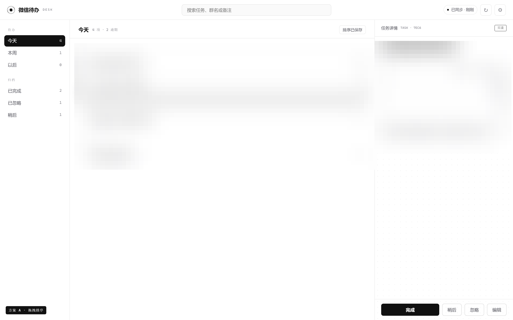
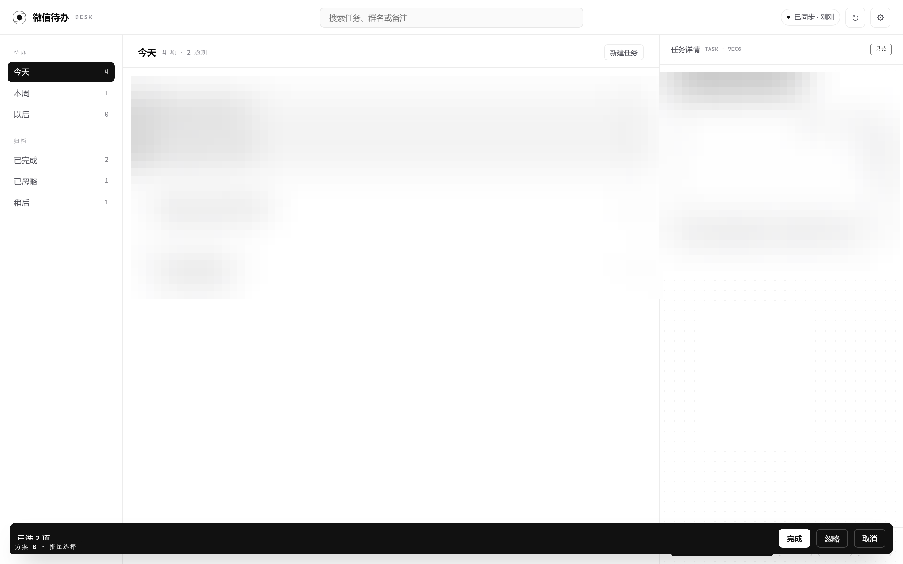
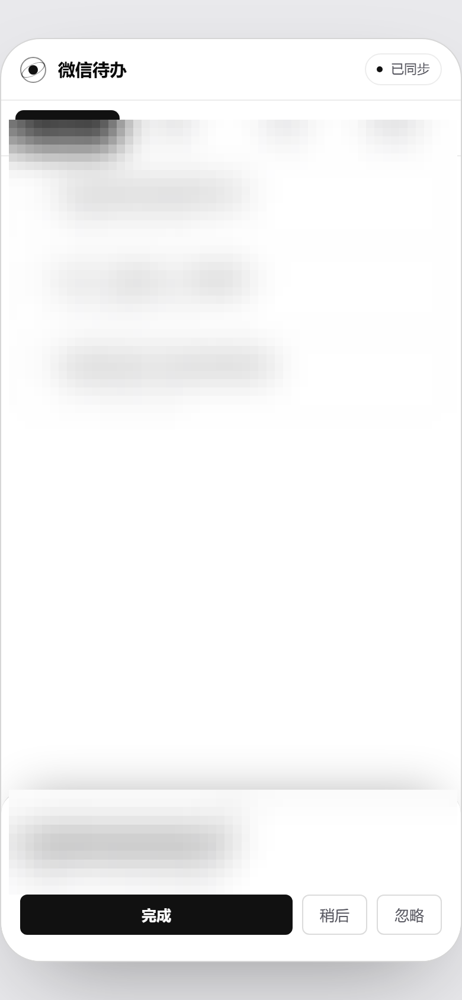

# 批次 3 候选方案（供选择）

> **已选定并实施**：方案 B（批量选择）+ 真删除，交付说明见 [前端优化-批次3-交付.md](前端优化-批次3-交付.md)。
> 方案 A（拖拽排序）、方案 C（手机端专项）暂未实施，本文保留作为后续选型参考。

> 批次 1（桌面三栏 + 编辑 + 找回 + 撤销 + gzip/notes）与批次 2（搜索 + 时间分组 + 键盘 + 设置页 + Brotli + 宽屏占比）已交付。
> 批次 3 为「按需」，下面三个方向都做了效果图，选中的我再落实现。效果图在 `output/frontend-preview-v2/`。

## 方案 A · 拖拽排序

- 列表左侧出现拖拽手柄，拖动时行浮起、显示插入位置；松手保存顺序。
- **代价**：后端需要新增排序字段（如 `tasks.sort_order`）+ PATCH 接口，前端做 dnd + 触摸兼容；分组视图下要定义「排序只在同一分组内生效」。
- 工作量约 **1 天**，风险中（涉及数据模型小改；可先做「仅本机排序」放 localStorage，半天，但跨设备不同步）。
- 适合：任务多、希望按自己的优先级手动排。

## 方案 B · 批量选择

- 列表进入多选态：行首复选框、Shift 连选；底部黑色操作条「已选 N 项 · 完成 / 忽略 / 取消」。
- **纯前端**（批量串行 PATCH），不动后端与数据模型。
- 工作量约 **0.5 天**，风险低。
- 适合：一次清理多条已完成/忽略任务。

## 方案 C · 手机端黑白专项

- 手机端继续保持现有布局，但把触控热区做到 ≥44px、抽屉支持下滑关闭、支持下拉刷新、补上搜索与「已忽略/稍后」入口、手机端任务编辑。
- 工作量约 **1 天**，风险低，但需要真机（iOS Safari / Android Chrome）验证。
- 备注：目前手机端已同步黑白配色，只是没做手机专属交互（当初约定「手机端 UI 后续单独做」）。

## 其它可选项（未做效果图）

| 项 | 说明 | 工作量 | 风险 |
| --- | --- | --- | --- |
| 桌面通知 | Notification API 授权 + 到期提醒（页面打开时） | 0.5 天 | 低 |
| 离线写队列 | IndexedDB 暂存 PATCH/POST，联网重放 | 1.5 天 | 高（冲突处理复杂） |
| 真删除 | 需要后端 `DELETE /api/tasks/{id}`，用于清理已忽略 | 0.5 天 | 中（数据不可恢复） |

## 建议顺序

1. **B（批量选择）**：投入最小、日常清任务收益最直接；
2. **C（手机端专项）**：你手机用得不少，补齐触控与找回入口；
3. **A（拖拽排序）**：需要后端加字段，建议等 B/C 之后再评估。

## 同时待确认

- 电脑端超宽屏限宽：当前 ≥2208px 时整体限宽居中；可选「保持 / 放大到 2400 / 去掉上限」。
- `j/k` 是否联动右侧详情（当前只移动选中，`Enter`/`e` 才打开详情）。
